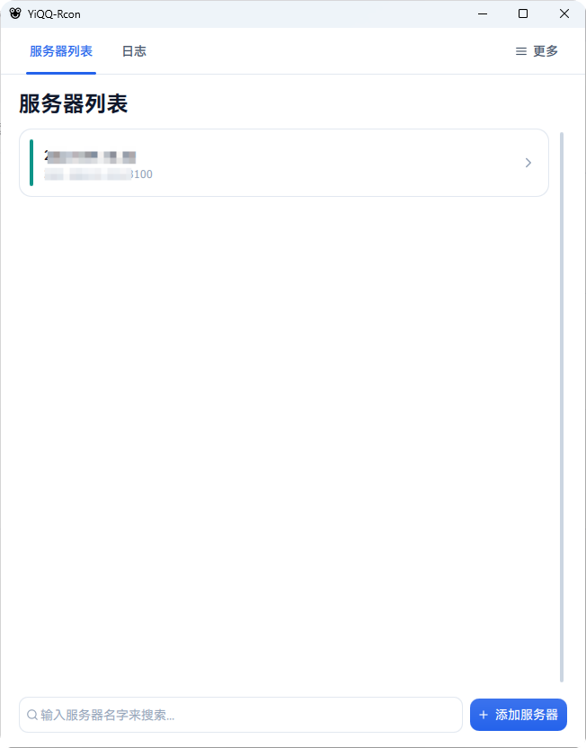
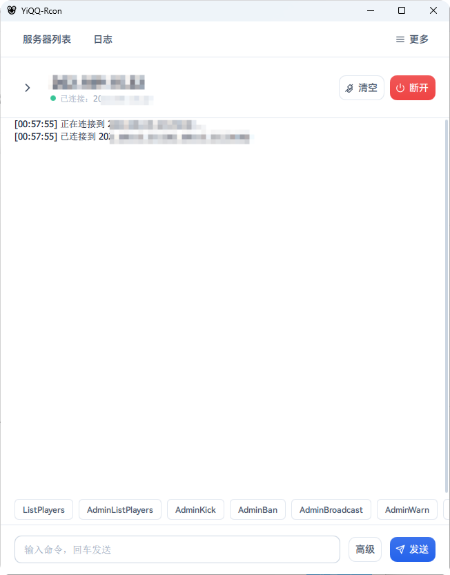

# YiQQ-Rcon
基于 Python + PySide6 + QML 构建的现代风格 RCON 管理工具，支持多种游戏服务器的远程管理。

<table>
  <tr>
    <td></td>
    <td></td>
  </tr>
</table>

## 功能特性

- **多服务器管理** - 集中管理多个 RCON 服务器，一键切换连接
- **密码加密存储** - 跨平台本地加密（Windows 使用 DPAPI，macOS/Linux 使用 Fernet 派生密钥）
- **SOCKS5 代理** - 支持通过 SOCKS5 代理连接 RCON 服务器
- **命令历史** - 按服务器记录命令历史，支持重发
- **快捷命令** - 内置多种游戏常用命令模板，一键执行
- **原始数据包查看** - 高级模式下可查看 RCON 收发的原始数据包
- **多语言支持** - 简体中文 / English
- **主题切换** - 浅色 / 深色 / 跟随系统
- **运行日志** - 实时查看应用运行日志
- **MCP 服务** - 让 Claude、Qoder 等 AI 客户端直接管理游戏服，命令可按你设定的禁止列表拦截

## 支持的游戏

支持任何使用 Source RCON 协议的游戏服务器，以下经过测试并拥有快捷命令的游戏：

- Minecraft
- Squad
- Counter-Strike 2
- 幻兽帕鲁 (Palworld)

## MCP 服务（AI 客户端接入）

应用内置一个 stdio 协议的 MCP 服务：AI 客户端（Claude Desktop、Cursor、Qoder 等）连上后可以直接查询和操作你已经配置好的服务器。服务器地址与密码留在本机，不会发送给模型。

### 开启

设置 → MCP 服务 → 勾选「启用 MCP 服务」。同级的「禁止命令」列表决定 AI 不能碰哪些命令，列表为空时不拦任何命令。

匹配方式跟着每条命令走，添加时选一次，之后用每条命令后面的下拉随时改：

| 匹配方式 | 条目 `stop` 的效果 |
| --- | --- |
| 前缀（默认） | 拦 `stop`、`stop server`、`stopwatch 1`；不拦 `backup stop` |
| 包含 | 命令任意位置出现 `stop` 就拦，含 `backup stop` |
| 精确 | 只拦首词等于 `stop` 的命令；`stopwatch 1` 不拦 |

条目里写 `*` 时按通配匹配整条命令（`ban*` 一次拦掉 `ban`、`banplayer`、`BanPlayer 123`），此时与匹配方式无关。各游戏的命令名差别很大，同一份列表里可以混着写「帕鲁的 `ban*` 走前缀、CS 的 `mp_restartgame` 走精确」。

不勾选启用时 MCP 进程直接拒绝启动。禁止列表与服务器列表改动后无需重连：MCP 会话会按文件变化即时读取最新的服务器与列表。

### 客户端配置

设置页的「复制客户端配置」按钮会按当前安装位置生成可直接粘贴的 JSON：

```json
{
  "mcpServers": {
    "yiQQ-rcon": {
      "command": "C:\\Program Files\\YiQQ-Rcon\\YiQQ-Rcon-MCP.exe",
      "args": ["--mcp"]
    }
  }
}
```

Linux 将 `command` 换成安装目录下的 `YiQQ-Rcon-MCP`。源码运行时指向入口脚本：

```json
{
  "mcpServers": {
    "yiQQ-rcon": {
      "command": "python",
      "args": ["/path/to/rcon/main.py", "--mcp"]
    }
  }
}
```

### 提供的工具

| 工具 | 作用 |
| --- | --- |
| `list_servers` | 列出已配置的服务器与当前禁止命令列表 |
| `server_status` | 查询单个服务器的在线情况，命令按游戏自动选择 |
| `run_command` | 执行一条 RCON 命令，命中禁止列表则拒绝 |
| `quick_commands` | 列出该游戏的内置命令模板与所需参数 |
| `run_quick_command` | 按模板填参数执行 |

### 安全说明

- 命中禁止列表的命令直接拒绝，并把被哪一条拦下告诉模型；列表以外的命令不做预判。
- 拒绝包含分号、换行、反引号的命令与参数，避免一条命令绕过禁止列表。
- 每次执行与每次拒绝都会追加写入数据目录下的 `mcp_audit.log`。
- Windows 上密码由 DPAPI 加密，仅同一登录账户可解密；用服务账户或计划任务拉起 MCP 进程会读不到密码。
- 响应超过 6 万字符会被截断并在结果中标记 `truncated`。

## 技术栈

- Python 3.11+
- PySide6 (Qt for Python)
- QML / Qt Quick
- PyInstaller（打包构建）
- PySocks（代理支持）
- mcp（MCP 服务，仅在需要 AI 接入时用到）

## 环境要求

- Windows 10/11、macOS 11+、主流 Linux 桌面发行版
- Python 3.11+ (Releases 打包版本无需安装)

## 快速开始

> Windows 用户可直接从 [Releases](https://github.com/danTvT4730/YiQQ-Rcon/releases) 下载完整安装包，开箱即用。
>
> Linux 版提供 `.deb` 安装包，适配 Ubuntu 22.04+ / Debian 12+，也可按下方「构建打包」自行构建。
>
> macOS 用户需自行编译，参考下方「构建打包」章节。

1. 克隆仓库

```bash
git clone https://github.com/danTvT4730/YiQQ-Rcon/rcon.git
cd rcon
```

2. 安装依赖

```bash
pip install PySide6 PySocks cryptography mcp
```

3. 运行程序

```bash
python main.py
```

## 构建打包

使用 PyInstaller 打包为独立可执行文件：

```bash
pip install pyinstaller
pyinstaller build.spec        # Windows
pyinstaller build_linux.spec  # Linux
```

构建产物位于 `dist/YiQQ-Rcon/` 目录下，同目录含 `YiQQ-Rcon` 与 `YiQQ-Rcon-MCP` 两个入口，后者是供 AI 客户端拉起的控制台版 MCP 服务。Linux 版建议在与目标系统一致的发行版上构建，产物基线为 glibc 2.35。

## 项目结构

```
rcon/
├── assets/                 # 资源文件
│   ├── fonts/              #   字体（HarmonyOS Sans SC）
│   ├── i18n/               #   国际化文案
│   └── avatar.png          #   头像
├── core/                   # 核心业务逻辑
│   ├── rcon_client.py      #   RCON 协议客户端
│   ├── server_manager.py   #   服务器管理
│   ├── security.py         #   密码加解密（DPAPI / Fernet）
│   ├── config_manager.py   #   配置管理
│   ├── command_history.py  #   命令历史
│   ├── quick_commands.py   #   快捷命令模板
│   ├── mcp_server.py       #   MCP 服务（stdio，供 AI 客户端调用）
│   ├── i18n.py             #   国际化
│   └── paths.py            #   路径处理
├── ui/                     # UI 层
│   ├── bridges/            #   QML 桥接对象
│   ├── icon_provider.py    #   图标提供器
│   └── rcon_worker.py      #   RCON 工作线程
├── qml/                    # QML 界面
│   ├── Theme/              #   主题
│   ├── components/         #   通用组件
│   ├── dialogs/            #   对话框
│   ├── pages/              #   页面
│   ├── main.qml            #   主界面
│   └── utils.js            #   工具函数
├── data/                   # 运行时数据（已 gitignore）
│   ├── config.json         #   应用配置
│   ├── servers.json        #   服务器列表
│   └── history.json        #   命令历史
├── main.py                 # 程序入口
└── build.spec              # PyInstaller 构建配置
```

## 数据存储

- 开发模式：项目目录下的 `data/` 文件夹
- 打包后：`%APPDATA%/YiQQ-Rcon/`

服务器密码通过本地加密存储：Windows 使用 DPAPI（仅当前用户账户可解密），macOS/Linux 使用基于机器标识与用户名派生密钥的 Fernet 对称加密。

## 相关链接

- 官网：<https://rcon.qiovo.cn>
- 作者主页：<https://qiovo.cn>
